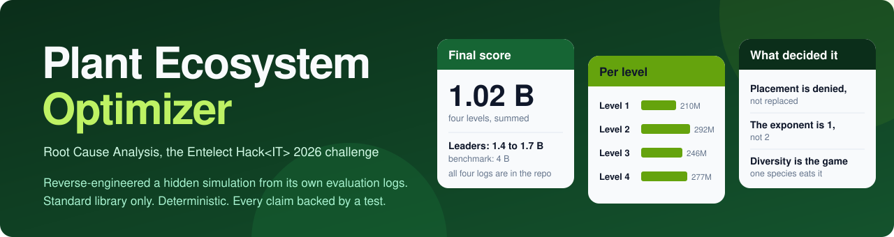
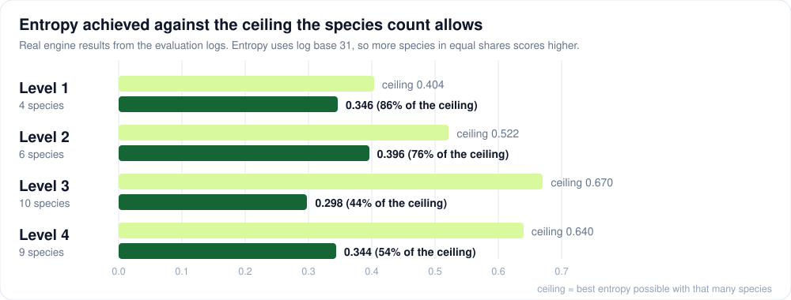

<p align="center">
  
</p>

<p align="center">
  
  
  
  
  
</p>

<p align="center">
  <a href="#the-problem-in-one-paragraph">The problem</a> &middot;
  <a href="#results">Results</a> &middot;
  <a href="#what-actually-mattered">What mattered</a> &middot;
  <a href="#repository-layout">Layout</a> &middot;
  <a href="#running-it">Run it</a>
</p>

A solver for **Root Cause Analysis**, the Entelect Hack&lt;IT&gt; 2026 optimisation
challenge. You are given a grid, 31 plant species with interlocking growth rules,
a hidden simulation engine, and a scoring function, and you must emit a static
list of planting actions that produces the most diverse, densest possible garden
on one specific final tick.

Final score: **just over 1 billion** across the four levels.

---

<table align="center">
  <tr>
    <td align="center"><b>1.02 B</b><br>final score,<br>four levels</td>
    <td align="center"><b>31</b><br>plant species,<br>interlocking rules</td>
    <td align="center"><b>222</b><br>tests</td>
    <td align="center"><b>0</b><br>dependencies</td>
    <td align="center"><b>20</b><br>plantings<br>per tick</td>
  </tr>
</table>

## The problem in one paragraph

A garden is an `N × M` grid simulated for `T` discrete ticks. Each tick you may
plant at most **20** seeds. Plants mature, spread by their own geometry
(VonNeumann / Moore / Row / Column / CrossHatch), compete for soil, cast shade,
and die when a cell's nutrients run out. Most of the 31 species are locked behind
a dependency tree of coverage thresholds and animal species that only appear when
the garden meets their requirements. **Only the final tick is scored.**

```
score = 0.8 · (entropy × density) + 0.2 · longevity
entropy = −Σ pᵢ·log₃₁(pᵢ)          density = populated cells / total cells
```

Entropy uses log base 31 — the total species count in the game — so it rewards
*many species in equal proportions*, not just many species.

---

## Repository layout

```
src/
  engine/          our reconstruction of the hidden simulation engine
    data.py          loads the plant / animal / unlock / classification datasets
    world.py         grid, terrain, soil, nutrients, dead matter
    sim.py           tick loop: maturity → spread → death → animals → unlocks
    scoring.py       entropy, density and longevity scoring
    analysis.py      static analysis of the unlock graph (reachability, waves)
    actions.py       builds the submission JSON, enforces the 20/tick budget
  solvers/
    level1.py        greenhouse: a pure construction problem
    level2.py  level3.py  level4.py
    cascade.py       the shared unlock-cascade planner used by levels 2–4
    experimental/    approaches that were tried and measured but not shipped
  run.py           generate (and simulate) a level's solution
  validate.py      independent constraint checker for a solution.json

docs/              full analysis: mechanics, scoring, unlock tree, results
logs/              the REAL evaluation logs returned by the official engine
problem-statement/ the provided specification and datasets
submissions/       generated solution.json + packaged zip per level
tests/             222-test suite (stdlib unittest, no pytest)
```

## Running it

Standard library only — no dependencies.

```bash
python src/run.py --level 2      # generate + simulate one level
python src/run.py --all          # all four
python src/validate.py 2         # independently re-check the output
python build.py                  # package a submission zip per level
python tests/run_tests.py        # full test suite
```

Everything is deterministic: the same input always produces the same
`solution.json`, which the competition rules required.

---

## Results

Final scores, from the official evaluation logs in [`logs/`](logs/):

| Level | Score | Entropy | Density | Species | Entropy ceiling |
|---|---:|---:|---:|---:|---:|
| 1 | 209,636,426 | 0.3463 | 0.7200 | 4 | 0.4037 |
| 2 | 291,811,331 | 0.3958 | 0.8670 | 6 | 0.5218 |
| 3 | 245,661,742 | 0.2981 | 0.8129 | 10 | 0.6705 |
| 4 | 276,528,784 | 0.3437 | 0.8823 | 9 | 0.6398 |
| **Total** | **1,023,638,283** | | | | |

The competition benchmark was 4 billion, and the leading entries finished near 1.4 to 1.7 billion. Density was never the problem, because a fast spreader fills around 85% of the map whatever you do. Entropy was, and the gap between what was achieved and what the species count allows is where the remaining score was:

<p align="center"></p>

## What actually mattered

The interesting part of this problem was not the search, it was that **the
specification is wrong in places, and the only way to find out is to submit and
read the engine's own logs.** Three corrections, each found by replaying a
submitted plan against the returned evaluation log:

**1. Placement onto an occupied cell is denied, not replaced.**
The problem statement says the existing plant "will be replaced by your new
plant". The engine log says `Placement denied ...: plant already occupies cell`.
Every rebalancing-by-overwrite action we emitted was silently discarded. This
also means **planting order decides who owns the map** — whoever plants first
keeps the ground.

**2. α = 1.** The scoring function is `main = entropy × density^α` with α
undisclosed. Calibrating from Level 1 alone suggested α ≈ 2, and that was wrong —
it assumed our simulated garden matched the real one. The Level 3 log printed
`entropy`, `density_factor` and `main_score` directly, and `entropy × density`
reproduced `main_score` exactly. An assumption that survives one data point is
not a fact.

**3. Diversity is the whole game, and one species will eat it.**
Density looks after itself — a fast spreader fills ~85% of the map whatever you
do. Entropy is what collapses. Measured on the real engine:

| Level | Monopolist | Entropy | Ceiling | Achieved |
|---|---|---|---|---|
| L3 | Oak 68.8% + Razorgrass 18.8% | 0.298 | 0.670 | 44% |
| L4 | Razorgrass 56.9% + Oak 24.9% | 0.344 | 0.640 | 54% |

Oak Tree was the worst offender twice over: it monopolised the garden *and*, once
mature, shaded a radius of 4, which killed every Grass plant. Grass coverage ≥ 4%
is what summons the Loamcrawlers animal, which gates most of the unlock tree — so
one species quietly locked us out of a 30-species level, leaving 4.

The fix was to deny the runaways *time* rather than space: release Oak and
Razorgrass only in the final ~12 ticks, where they still count as species but
never mature, never spread and never shade.

**A failure worth recording:** on Level 2 the garden finished with Lavender on
**108 cells = 1.5%** — just under the 2% the Nectaris animal requires. No
Nectaris meant no Crimson Vine, no Orange Blossom, and only 6 of 28 species ever
unlocked. A single species falling half a percent short cost most of the level.

`docs/results.txt` lists every optimisation that was tried and **failed**, with
its measured cost — two-zone maps, seed staggering, spread-speed weighting, seed
caps — because those rule out whole branches of the search space.

---

## Third-party material

[`problem-statement/`](problem-statement/) holds the specification and the datasets that Entelect provided to participants of the Hack&lt;IT&gt; 2026 Root Cause Analysis challenge. They are kept here only so that the engine and the tests can run. They remain Entelect's and are not covered by this repository's licence.

## Licence

[MIT](LICENSE) for the code and the analysis in this repository, except for the third-party material above.
